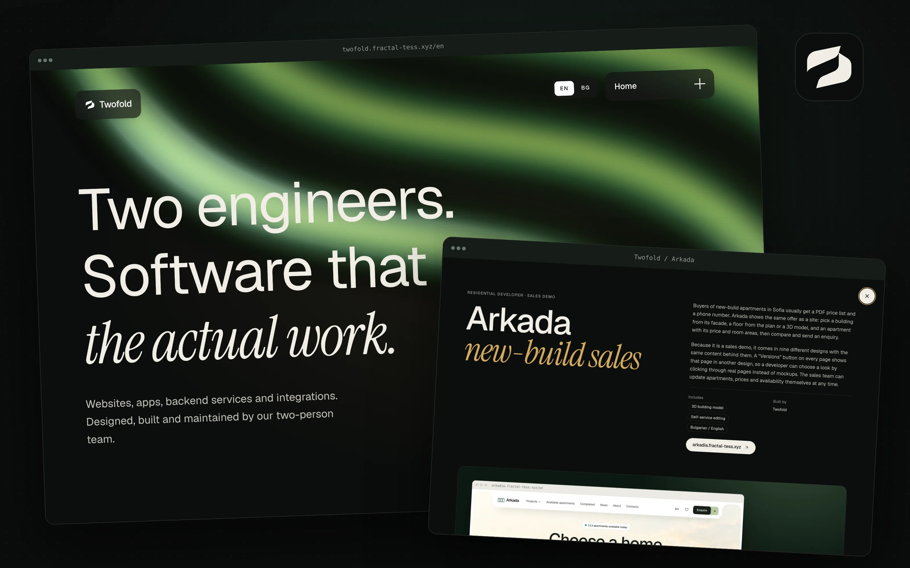

  

<h1 align="center">Twofold</h1>

Two engineers. Websites, apps, and the software behind them.

### From the workshop

| Project | What it does |
| --- | --- |
| ⛏️ [Chunkyard](https://github.com/twofold-studio/chunkyard) | Run your Minecraft servers, follow the console, and back up your worlds. |
| 📽️ [Oxevu](https://github.com/twofold-studio/oxevu) | Give your own media library a place to live and play. |
| ✳️ [Twofold](https://github.com/twofold-studio/twofold) | The studio portfolio, in Bulgarian and English. |

<a href="https://twofold.fractal-tess.xyz/">Visit the studio ↗</a>

